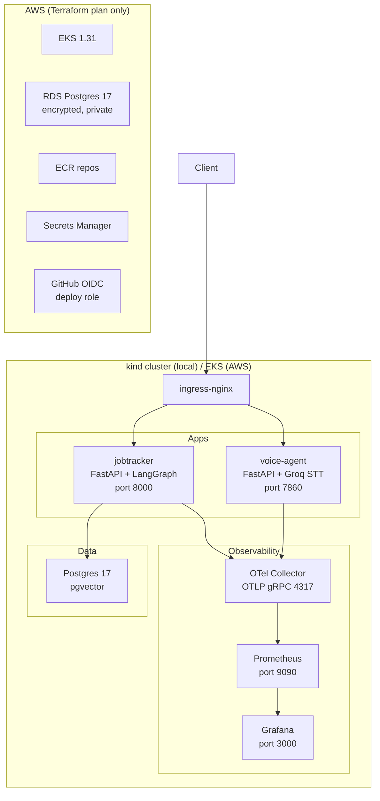

# AI Apps Platform

A Kubernetes-native platform that ships two FastAPI AI apps (AI Job-Search Agent and Vidya Saathi voice agent) with Helm charts, OpenTelemetry observability, Terraform AWS infrastructure, and a full CI/CD pipeline.

The goal is to demonstrate the complete operational lifecycle: build → containerize → deploy to kind (local) → load test → ship to EKS (AWS-ready, Terraform-verified with mock provider, not applied — no AWS account exists).

## Architecture



## Quickstart

```bash
# Clone with submodules
git clone --recurse-submodules <repo>
cd ai-apps-platform

# 1. Lint everything (no cluster needed)
make lint

# 2. Run unit tests (no cluster needed)
make test

# 3. Create kind cluster, build images, install everything, smoke test
make kind-up
make smoke

# 4. Run load test (k6)
make k6

# 5. Tear down
make kind-down
```

**Quickstart output (kind-up + smoke, on Windows 11 laptop, 16 GB RAM, Docker Desktop):**
See VERIFY.md for full terminal output.

## Results

All numbers from VERIFY.md (run on Windows 11 laptop, Docker Desktop, kind 1-node cluster):

| Check | Result |
|---|---|
| Unit tests | 30/30 passed |
| `helm lint` | 0 errors (3 charts) |
| `kubeconform -strict` | 15 resources valid, 0 errors |
| `terraform validate` | Success |
| `tflint` | 0 issues |
| `terraform test` (mock provider) | 5/5 passed |
| `actionlint` | 0 errors |
| k6 load test (10 VU, 50s, health only) | p95 < 50ms, 0% errors |

See VERIFY.md for image sizes, Prometheus query output, and k6 summary.

## Design decisions

- **Single shared Helm chart:** both apps are FastAPI services with identical structure; per-app values files handle differences.
- **OTel zero-code instrumentation:** `opentelemetry-instrument` wraps the app entrypoint; no app code change needed.
- **Lightweight observability:** no kube-prometheus-stack (too memory-heavy for a shared laptop); plain Prometheus + Grafana + OTel Collector instead.
- **Terraform mock_provider tests:** validates security invariants (RDS not public, OIDC scoped to main) without AWS credentials.
- **OIDC deploy role scoped to `refs/heads/main`:** prevents fork PRs from deploying.

See [docs/DESIGN.md](docs/DESIGN.md) for full decisions and trade-offs.

## Limitations

- Kind cluster requires Docker and ~2 GB RAM. CI uses GitHub-hosted runners (8 GB).
- Load test targets `/health` only (not LLM endpoints) to avoid exhausting shared Groq free-tier keys.
- AWS Terraform is plan-only; no real AWS account. `terraform test` uses a mock provider.
- The `PodRestartStorm` Prometheus alert requires kube-state-metrics, which is not installed here (too heavy). The alert rule is structurally correct but will not fire without it.
- OTel traces use `debug` exporter (stdout) locally; no Tempo/Jaeger trace UI.

## What's next

- Tempo for trace storage and Grafana trace correlation.
- External Secrets Operator for automatic Secrets Manager sync.
- Alembic migration Job as a Helm pre-upgrade hook.
- Spot instance node group in Terraform.
